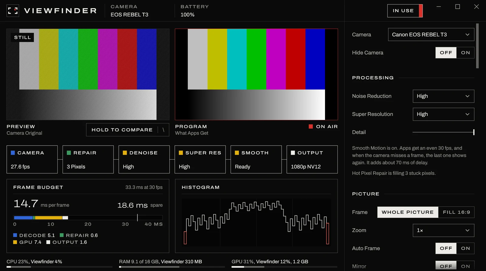
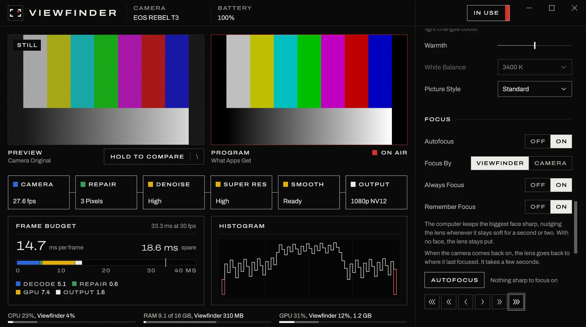
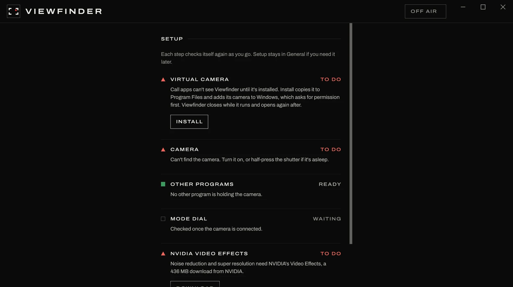

# Viewfinder

A free webcam app that turns a Canon EOS Rebel T3 into a Windows 11 webcam, a camera Canon's EOS Webcam Utility leaves out. It also takes other EOS and PowerShot bodies, Nikon and Sony live view, and ordinary webcams, and shows up as a camera in Zoom, Teams, Google Meet, Discord, OBS and your browser.

**[Download Viewfinder.zip](https://github.com/SomethingObvious/viewfinder/releases/latest/download/Viewfinder.zip)** for Windows 11, or see [the website](https://somethingobvious.github.io/viewfinder/).



## What It Does

* Drives the camera over USB with Canon's own commands, at about 28 fps of live view on a T3.
* Keeps exposure steady and sets white balance by your skin, so a lamp turning on doesn't turn you orange.
* Focuses on the biggest face, keeps it sharp when you lean in or sit back, and puts the lens back where it was when the camera comes on.
* Cleans each frame with NVIDIA's VideoSuperRes noise reduction and super resolution on RTX cards, and sharpens on the CPU without one.
* Fills in stuck pixels on an older sensor.
* Sends apps an even 30 fps, filling a frame the camera missed with the last one.
* Adjusts exposure, contrast, colour and more, with Auto Adjust to set them in one press.
* Hides the camera with Ctrl+Alt+H and runs autofocus with Ctrl+Alt+F, even while another app is in front.



## Install

1. Download [Viewfinder.zip](https://github.com/SomethingObvious/viewfinder/releases/latest/download/Viewfinder.zip) and unzip the whole thing into a folder.
2. Open `viewfinder.exe` in that folder. The app isn't signed, so if Windows says it protected your PC, choose More Info and then Run Anyway. Setup opens and checks each part by itself.
3. Press Install. Windows asks for permission, and then Viewfinder copies itself to Program Files, adds its camera to Windows and opens again from there.
4. With an NVIDIA RTX card, press Download to get NVIDIA's Video Effects (about 436 MB), then Restart Viewfinder.
5. Turn the camera on with the mode dial on P, Tv, Av or M, and plug it in over USB. Quit EOS Utility if it opens, since only one program can use the camera at a time.

Then pick Viewfinder in your call app's camera list. Setup stays in General if anything changes later. The camera stays in that list while Viewfinder is closed and shows dark grey until it opens again.

Windows lets only one app use a camera at a time. To have a call and OBS both use Viewfinder, open Settings, then Bluetooth & Devices, Cameras, Viewfinder and Advanced Camera Options, and turn on Allow Multiple Apps to Use Camera at the Same Time. Windows remembers that for as long as Viewfinder is installed.



To update, quit Viewfinder from the tray, unzip the new release and open it. Setup offers Install again, which replaces the old copy. To remove it, run this from an administrator PowerShell:

```powershell
& "$env:ProgramFiles\Viewfinder Webcam\install.ps1" -Uninstall
```

## Building It

```powershell
cargo build --release
.\scripts\install.ps1
```

The second line needs an administrator PowerShell, and `.\scripts\lint.ps1` runs every check.

## Licence

Viewfinder is under the [MIT licence](LICENSE). The Archivo fonts are under the [SIL Open Font License](crates/app/assets/fonts/OFL.txt), and NVIDIA's Video Effects come from NVIDIA under their own licence. Viewfinder isn't affiliated with Canon, Nikon, Sony or NVIDIA.
