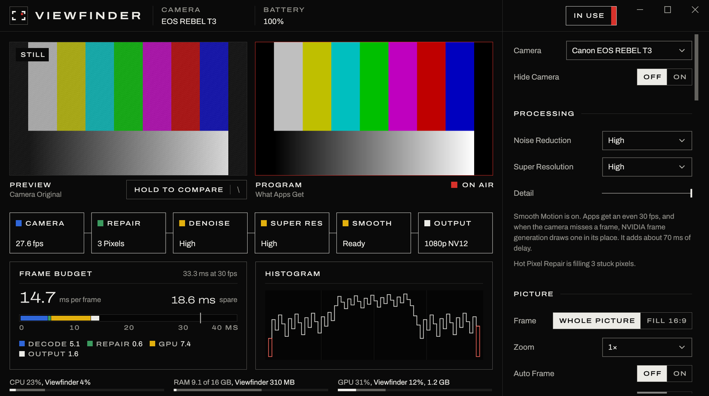

# Viewfinder

Turns a Canon EOS Rebel T3 into a webcam on Windows 11. It also takes other EOS and PowerShot bodies, Nikon and Sony live view, and ordinary webcams.



It keeps exposure and white balance steady, focuses on your face and remembers where, and cleans up each frame with NVIDIA's VideoSuperRes on RTX cards.

## Install

Download the zip from Releases, unzip it, and run this from an administrator PowerShell in that folder:

```powershell
.\install.ps1
```

The first install downloads NVIDIA's Video Effects (about 440 MB). `.\install.ps1 -Uninstall` removes everything. To build it yourself, run `cargo build --release` and then `.\scripts\install.ps1`.

Keep the mode dial on P, Tv, Av or M, and quit EOS Utility first, since only one program can use the camera at a time.
